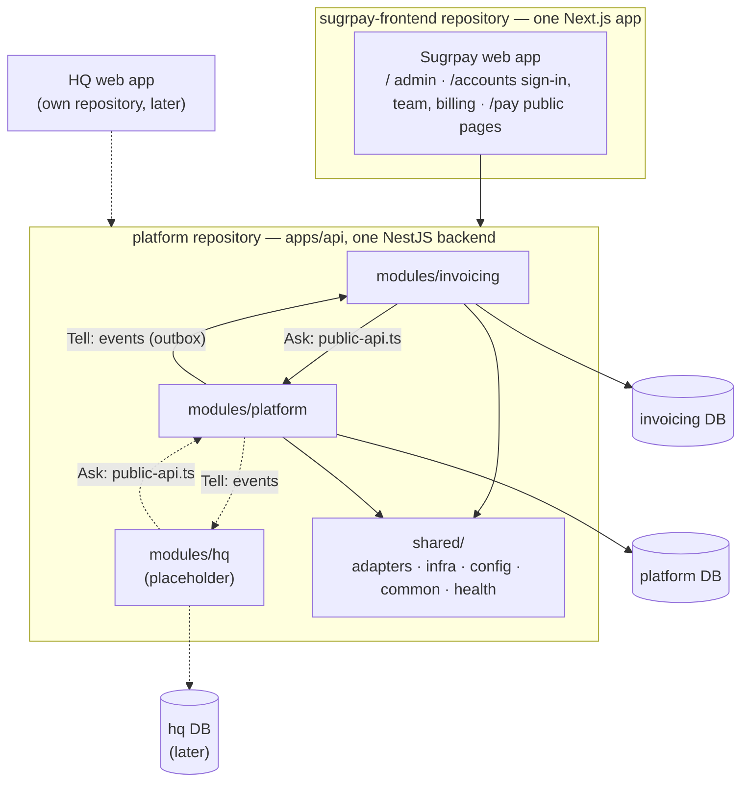

# Architecture

**One platform, several products, one backend.** The platform owns what every
product needs — login, companies, brands, users, roles, subscriptions,
locations, integrations and audit. Each product (Sugrpay invoicing today, HQ next) is built
on top of it and never on top of another product.

The backend is a **modular monolith**: a single NestJS application made of
walled-off modules, each with **its own database**. Any module can later be run
as its own service without a rewrite (see
[decisions/0001](decisions/0001-modular-monolith.md)).

**Two repositories.** This one (`platform`) is the backend only: the API,
its databases and the packages it is built from. The Sugrpay web app — one
Next.js app serving the admin at `/`, sign-in and team at `/accounts` and the
public payment pages at `/pay` — lives in
[primeshelfspace/sugrpay-frontend](https://github.com/primeshelfspace/sugrpay-frontend)
and reaches the backend only over HTTP. A future product (HQ) gets its own web
app repository the same way. The front end keeps copies of
`kernel`, `platform-contracts` and `invoicing-contracts` (see its
`packages/README.md`); the copies here are the source of truth.



There is deliberately no arrow between the two products.

## Read next

| Document                                         | Covers                                                   |
| ------------------------------------------------ | -------------------------------------------------------- |
| [principles.md](principles.md)                   | The rules that must not break: money, tenant isolation   |
| [modules.md](modules.md)                         | The module rules, public APIs, and the folder layout     |
| [layers.md](layers.md)                           | Clean architecture inside a feature (domain → interface) |
| [databases.md](databases.md)                     | One database per module, roles, row-level security       |
| [events.md](events.md)                           | The outbox, delivery guarantees, published events        |
| [products-and-access.md](products-and-access.md) | Subscriptions, roles per product, locations, one sign-in |
| [adding-a-product.md](adding-a-product.md)       | Step by step: bringing HQ (or any product) online        |
| [decisions/](decisions/)                         | Architecture decision records                            |

## Repository map

```
apps/
  api/                      the backend (modular monolith) + background worker
    src/
      modules/
        platform/           shared core: auth, companies, brands, users,
                            subscriptions, locations, tenancy,
                            integrations, audit, events
        invoicing/          Sugrpay: customers, invoices, payments, pay API,
                            settings, Zoho sync, dashboard
        hq/                 HQ (placeholder)
      shared/               plumbing every module may use
        adapters/           ports to the outside world: payment gateway,
                            accounting (Zoho), mail, storage
        infra/              event bus + outbox dispatcher, queues, Redis,
                            scoped-transaction helpers
        config/             validated environment
        common/             small cross-cutting helpers
        health/             liveness/readiness endpoints
      app.module.ts         composition root (platform + ENABLED_PRODUCTS)
      main.ts               HTTP entry point
      worker.ts             queue worker entry point
    prisma/
      platform/             platform schema + migrations
      invoicing/            invoicing schema + migrations
      bootstrap.ts          creates module databases and roles
      seed.ts               development data for every module
      migrate-legacy.ts     one-off import of a pre-split database
packages/
  kernel/                   money, calculation, tenancy scope + roles, design tokens,
                            port interfaces, generic validation and reference data
  platform-contracts/       what the platform publishes: request schemas, events
  invoicing-contracts/      what invoicing publishes: schemas, statuses, email/PDF renderers
  hq-contracts/             what HQ will publish (placeholder)
deploy/                     server deploy (pm2 + build-slot script), nginx configs,
                            production/ helpers (secrets, certificates, RDS setup)
.github/workflows/          deploy.yml: checks, then deploy to the EC2 on push to main
docs/                       this documentation, product specs, integration notes
scripts/                    local setup, services, boot check, dependency check
eslint.config.mjs           the import rules (module boundaries, layers)
```
