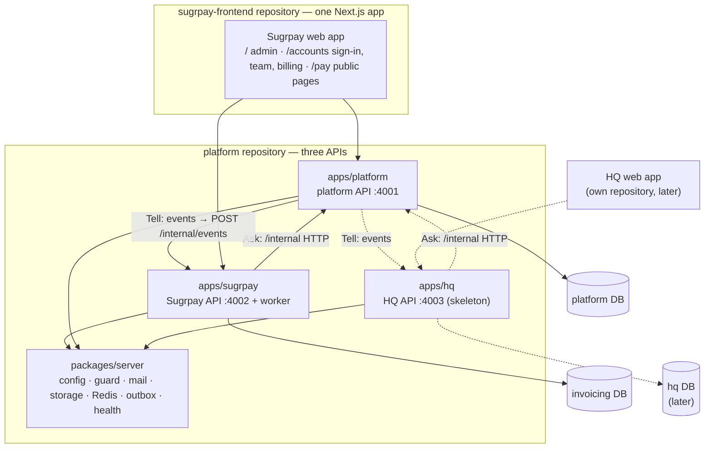

# Architecture

**One platform, several products, one API each.** The platform owns what every
product needs — login, companies, brands, users, roles, subscriptions,
locations, integrations and audit. Each product (Sugrpay invoicing today, HQ
next) is built on top of it and never on top of another product.

The backend is **three separate NestJS programs** in one repository — the
platform, Sugrpay and HQ — each with **its own folder, port, address and
database**. They never import each other's code or read each other's
database: they **ask** over HTTP (`/internal/...` routes) and **tell** through
events (see [decisions/0005](decisions/0005-separate-apis.md), which replaced
the single-process part of [decisions/0001](decisions/0001-modular-monolith.md)).

**Two repositories.** This one (`platform`) is the backend only: the APIs,
their databases and the packages they are built from. The Sugrpay web app —
one Next.js app serving the admin at `/`, sign-in and team at `/accounts` and
the public payment pages at `/pay` — lives in
[primeshelfspace/sugrpay-frontend](https://github.com/primeshelfspace/sugrpay-frontend)
and reaches the backend only over HTTP, sending each call to the API that owns
its path (`apiServiceFor` in `packages/platform-contracts/src/api-routing.ts`).
A future product (HQ) gets its own web app repository the same way. The front
end keeps copies of `kernel`, `platform-contracts` and `invoicing-contracts`
(see its `packages/README.md`); the copies here are the source of truth.



There is deliberately no arrow between the two products.

## Read next

| Document                                         | Covers                                                   |
| ------------------------------------------------ | -------------------------------------------------------- |
| [principles.md](principles.md)                   | The rules that must not break: money, tenant isolation   |
| [modules.md](modules.md)                         | The API boundaries, how APIs talk, and the folder layout |
| [layers.md](layers.md)                           | Clean architecture inside a feature (domain → interface) |
| [databases.md](databases.md)                     | One database per API, roles, row-level security          |
| [events.md](events.md)                           | The outbox, delivery guarantees, published events        |
| [products-and-access.md](products-and-access.md) | Subscriptions, roles per product, locations, one sign-in |
| [adding-a-product.md](adding-a-product.md)       | Step by step: bringing HQ (or any product) online        |
| [decisions/](decisions/)                         | Architecture decision records                            |

## Repository map

```
apps/
  platform/                 the platform API (port 4001)
    src/modules/            auth, companies, brands, users, subscriptions,
                            locations, tenancy, integrations, audit, events,
                            internal (/internal routes + EventForwarder)
    prisma/                 platform schema + migrations
  sugrpay/                  the Sugrpay API (port 4002) + background worker
    src/modules/            customers, invoices, payments, checks, pay API,
                            settings, Zoho sync, dashboard, platform-sync,
                            platform-access (how it reaches the platform)
    src/adapters/           payment gateway, accounting (Zoho)
    src/infra/queue/        BullMQ queues
    src/worker.ts           queue worker entry point
    prisma/                 invoicing schema + migrations
  hq/                       the HQ API (port 4003): a skeleton, no database yet
packages/
  server/                   what every API shares: config, request guard and
                            decorators, internal-call guard and client, mail,
                            storage, Redis, event bus + outbox dispatcher,
                            rate limits, security headers, app setup, health
  kernel/                   money, calculation, tenancy scope + roles, design tokens,
                            port interfaces, generic validation and reference data
  platform-contracts/       what the platform publishes: request schemas, events,
                            API routing (apiServiceFor)
  invoicing-contracts/      what Sugrpay publishes: schemas, statuses, email/PDF renderers
  hq-contracts/             what HQ will publish (placeholder)
e2e/                        end-to-end user journeys against both APIs
deploy/                     server deploy (pm2 + build-slot script), nginx configs,
                            production/ helpers (secrets, certificates, RDS setup)
.github/workflows/          deploy.yml: checks, then deploy to the EC2 on push to main
docs/                       this documentation, product specs, integration notes
scripts/                    local setup, services, boot check, dependency check
  db/                       bootstrap (creates databases and roles), seed,
                            migrate-legacy, move-zoho-connections
eslint.config.mjs           the import rules (API boundaries, layers)
```
