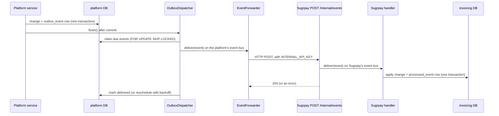

# Events

Events are the **Tell** half of how the APIs talk: "something happened". The
other half, **Ask**, is a call to the platform's `/internal/...` routes (see
[modules.md](modules.md#how-the-apis-talk)).

## How delivery works

- **Transactional outbox.** An event is written in the same transaction as
  the change it announces, so it exists if and only if the change committed.
- **Over HTTP.** The platform's `EventForwarder`
  (`apps/platform/src/modules/internal/event-forwarder.ts`) subscribes to
  every platform topic and posts each event to Sugrpay's `POST /internal/events`
  (`SUGRPAY_INTERNAL_URL`). Sugrpay puts it on its own event bus, so its
  handlers look the same as before the split. If Sugrpay is down or a handler
  fails, the call fails and the outbox retries.
- **Immediate, then retried.** The producer flushes right after committing,
  so subscribers usually see the change before the API call returns. A poll
  every `OUTBOX_POLL_INTERVAL_MS` (default 1 s, in the platform API) retries
  failures with backoff (1 s, 2 s, 4 s … up to 5 min) and picks up anything a
  crashed process left.
- **At least once.** Handlers must be idempotent: record the event id in the
  API's own `processed_event` table in the same transaction as the change.
- **Order is not guaranteed** across retries. Snapshot events carry a version
  (`updatedAt`); handlers ignore anything older than what they hold.

The code: `packages/server/src/events/` (bus, dispatcher), the platform's
outbox (`apps/platform/src/modules/events/platform-outbox.ts`) and forwarder,
Sugrpay's receiving end
(`apps/sugrpay/src/modules/platform-access/internal-events.controller.ts`) and
its handlers (`apps/sugrpay/src/modules/platform-sync/`).

## Published events

### Platform (`packages/platform-contracts/src/events.ts`)

| Topic                           | Payload                                  | Consumers                              |
| ------------------------------- | ---------------------------------------- | -------------------------------------- |
| `platform.brand.created`        | `{ brand: BrandSnapshot }`               | Sugrpay: brand copy + default settings |
| `platform.brand.updated`        | `{ brand: BrandSnapshot }`               | Sugrpay: brand copy                    |
| `platform.subscription.changed` | `{ subscription: SubscriptionSnapshot }` | none yet (billing, HQ later)           |
| `platform.location.created`     | `{ location: LocationSnapshot }`         | none yet (HQ later)                    |
| `platform.location.updated`     | `{ location: LocationSnapshot }`         | none yet (HQ later)                    |

Every topic is forwarded to Sugrpay; it ignores the ones it has no handler
for.

Planned (from the architecture plan): `platform.user.deactivated`,
`invoicing.invoice.issued / paid / cancelled` (for HQ stock reservations).

## Changing a contract

A published payload is an API. Add optional fields freely; rename or remove
a field only after every subscriber has stopped using it.
