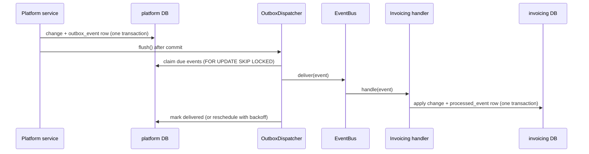

# Events

Events are the **Tell** half of how modules talk: "something happened". The
other half, **Ask**, is a call to a module's `public-api.ts`.

## How delivery works

- **Transactional outbox.** An event is written in the same transaction as
  the change it announces, so it exists if and only if the change committed.
- **Immediate, then retried.** The producer flushes right after committing,
  so subscribers see the change before the API call returns. A poll every
  `OUTBOX_POLL_INTERVAL_MS` (default 1 s, in the API and the worker) retries
  failures with backoff (1 s, 2 s, 4 s … up to 5 min) and picks up anything a
  crashed process left.
- **At least once.** Handlers must be idempotent: record the event id in the
  module's own `processed_event` table in the same transaction as the change.
- **Order is not guaranteed** across retries. Snapshot events carry a version
  (`updatedAt`); handlers ignore anything older than what they hold.

The code: `shared/infra/events/` (bus, dispatcher), each producer's outbox
(`modules/platform/events/platform-outbox.ts`), each consumer's handlers
(`modules/invoicing/platform-sync/`).

If a module is ever split into its own service, the dispatcher publishes to a
message broker instead; producers and handlers keep their shape.

## Published events

### Platform (`modules/platform/events/contracts.ts`)

| Topic                           | Payload                                  | Consumers                                |
| ------------------------------- | ---------------------------------------- | ---------------------------------------- |
| `platform.brand.created`        | `{ brand: BrandSnapshot }`               | invoicing: brand copy + default settings |
| `platform.brand.updated`        | `{ brand: BrandSnapshot }`               | invoicing: brand copy                    |
| `platform.subscription.changed` | `{ subscription: SubscriptionSnapshot }` | none yet (billing, HQ later)             |
| `platform.location.created`     | `{ location: LocationSnapshot }`         | none yet (HQ later)                      |
| `platform.location.updated`     | `{ location: LocationSnapshot }`         | none yet (HQ later)                      |

Planned (from the architecture plan): `platform.user.deactivated`,
`invoicing.invoice.issued / paid / cancelled`
(for HQ stock reservations).

## Changing a contract

A published payload is an API. Add optional fields freely; rename or remove
a field only after every subscriber has stopped using it.
