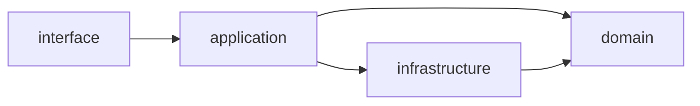

# Layers inside a feature

Each feature folder (`apps/sugrpay/src/modules/invoices`,
`apps/platform/src/modules/auth`, …)
follows **clean architecture**: four layers, and dependencies point inward
only.

```
<feature>/
  domain/           pure business rules — no Nest, no Prisma, no I/O
  application/      use cases: orchestrate domain + infrastructure
  infrastructure/   talks to the outside: database queries, external APIs
  interface/        the edge: HTTP controllers, request/response shapes
  <feature>.module.ts   Nest wiring for the feature
```



| Layer            | Contains                                                       | May import                                                               | Must not import          |
| ---------------- | -------------------------------------------------------------- | ------------------------------------------------------------------------ | ------------------------ |
| `domain`         | Calculations, state rules, value types, pure helpers           | `@platform/kernel`, contracts, own domain                                | Nest, Prisma, adapters   |
| `application`    | `*.service.ts` — one method per use case; transactions; events | domain, infrastructure, `@platform/server`, Sugrpay's `platform-access/` | interface                |
| `infrastructure` | Repositories (Prisma queries), external clients, mappers       | domain, the API's `database/`                                            | interface, application   |
| `interface`      | `*.controller.ts`, input schemas / DTOs, response mapping      | application, domain                                                      | infrastructure, database |

Tests sit next to what they test (`application/invoices.service.test.ts`).

## Where things already are

Money arithmetic, invoice calculation, the status machine and the role matrix
are already pure and shared — they live in `packages/kernel` and the contracts packages (the domain
kernel the APIs and the web apps use). A feature's own `domain/` holds the
rules that belong to that feature alone.

## Status

The layout is applied to every feature: controllers in `interface/`, services
in `application/`, pure rules in `domain/`, and data-access/external code in
`infrastructure/`. Some application services still contain Prisma queries
inline; moving those behind repositories in `infrastructure/` is done feature
by feature, starting with the largest files, without changing behaviour.
